# Especificação Técnica e Arquitetura — Plataforma de Marmitas

Documento técnico consolidado contemplando arquitetura, modelagem de dados, máquinas de estado, fluxos operacionais, segurança, LGPD, testes, infraestrutura e decisões técnicas do projeto.

---

## 1. Diagramas de Arquitetura e Fluxos (Mermaid)

### 1.1. Arquitetura Geral

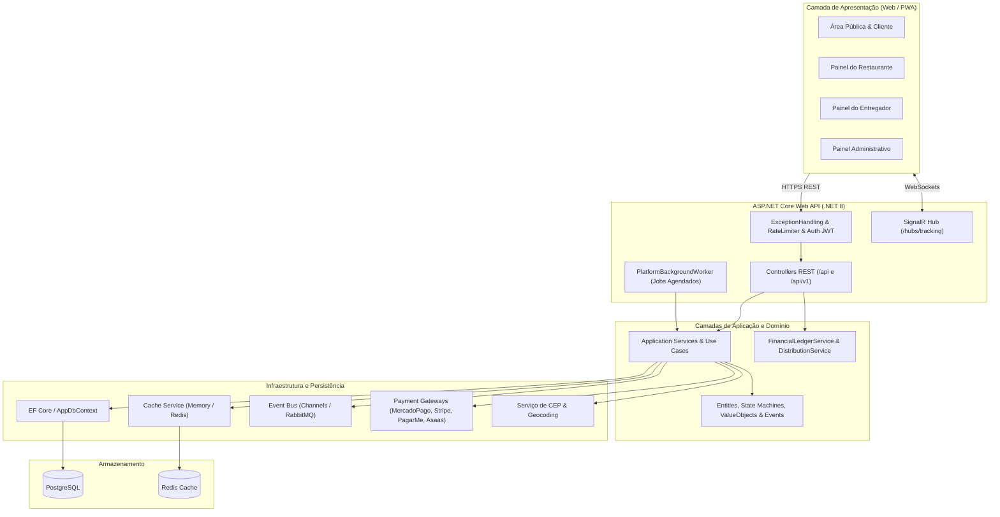

### 1.2. Diagrama de Componentes do Monólito Modular

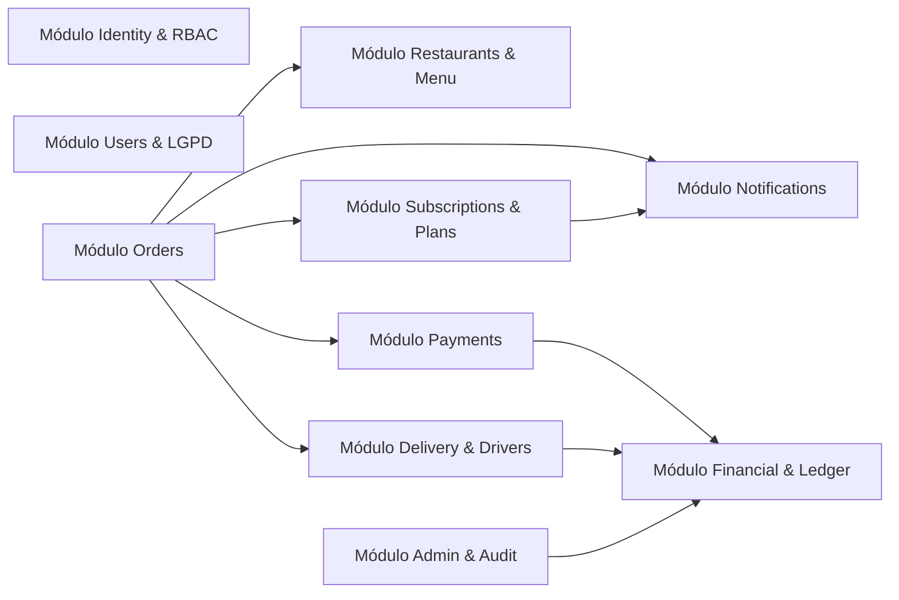

### 1.3. Fluxo do Pedido (Venda Avulsa)

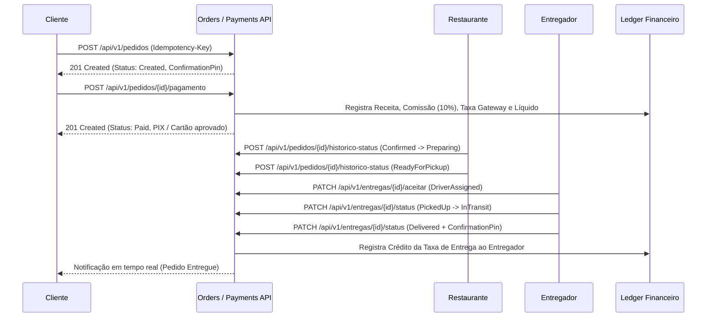

### 1.4. Fluxo de Pagamento e Webhook

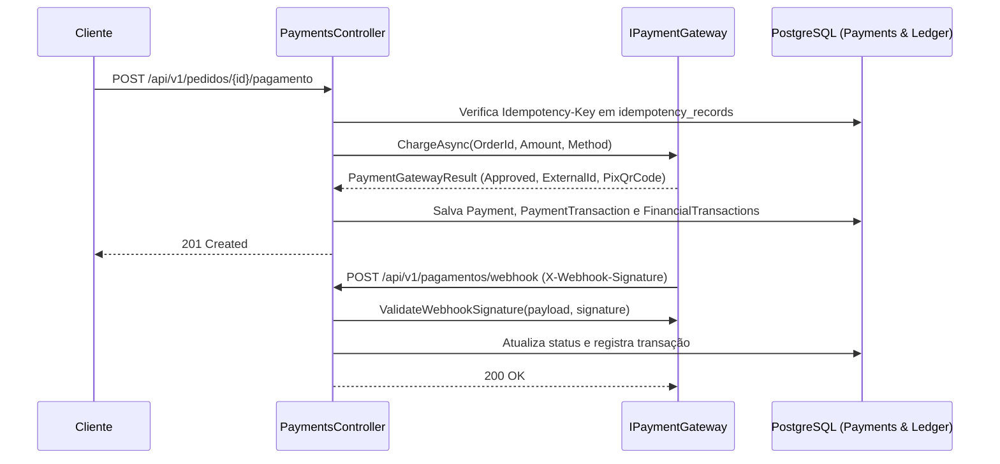

### 1.5. Fluxo de Assinatura e Resgate de Refeições

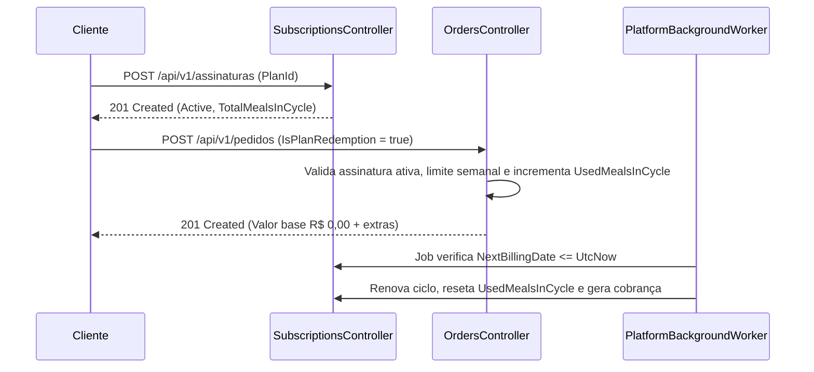

### 1.6. Fluxo de Entrega e Rastreamento GPS

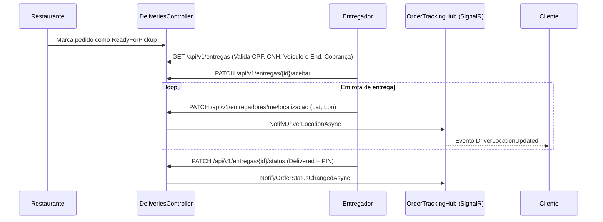

### 1.7. Fluxo de Autenticação, Refresh Token e RBAC

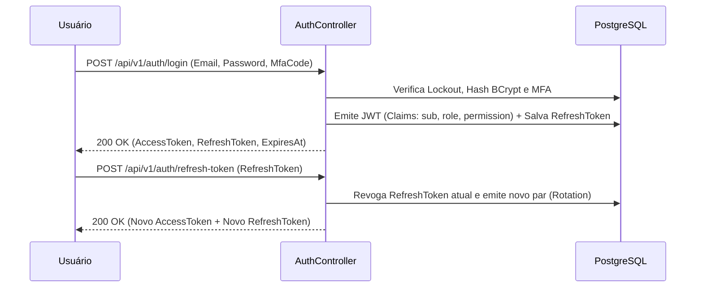

### 1.8. Comunicação Assíncrona e Jobs

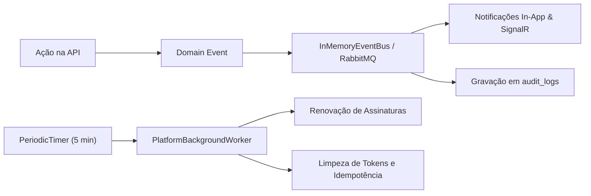

### 1.9. Diagrama Entidade-Relacionamento (DER)

```mermaid
erDiagram
    USERS ||--o{ USER_ROLES : possui
    ROLES ||--o{ USER_ROLES : atribui
    ROLES ||--o{ ROLE_PERMISSIONS : contem
    PERMISSIONS ||--o{ ROLE_PERMISSIONS : vincula
    USERS ||--o{ ADDRESSES : cadastra
    USERS ||--o{ USER_CONSENTS : aceita
    USERS ||--o{ REFRESH_TOKENS : mantem
    USERS ||--o{ SUBSCRIPTIONS : contrata
    PLANS ||--o{ SUBSCRIPTIONS : define
    SUBSCRIPTIONS ||--o{ SUBSCRIPTION_DELIVERIES : agenda
    RESTAURANTS ||--o{ RESTAURANT_USERS : emprega
    RESTAURANTS ||--o{ RESTAURANT_HOURS : funciona
    RESTAURANTS ||--o{ DELIVERY_ZONES : atende
    RESTAURANTS ||--o{ PRODUCTS : oferece
    PRODUCT_CATEGORIES ||--o{ PRODUCTS : classifica
    PRODUCTS ||--o{ PRODUCT_OPTIONS : possui
    USERS ||--o{ ORDERS : realiza
    RESTAURANTS ||--o{ ORDERS : recebe
    ORDERS ||--|{ ORDER_ITEMS : contem
    ORDERS ||--o{ ORDER_STATUS_HISTORIES : registra
    ORDERS ||--o| PAYMENTS : paga
    PAYMENTS ||--o{ PAYMENT_TRANSACTIONS : processa
    PAYMENTS ||--o{ REFUNDS : estorna
    ORDERS ||--o| DELIVERIES : gera
    COURIERS ||--o{ COURIER_DOCUMENTS : comprova
    COURIERS ||--o{ COURIER_VEHICLES : utiliza
    COURIERS ||--o{ DRIVER_LOCATIONS : reporta
    COURIERS ||--o{ DELIVERIES : executa
    ORDERS ||--o{ COMMISSIONS : gera
    ORDERS ||--o{ FINANCIAL_TRANSACTIONS : contabiliza
```

### 1.10. Diagrama de Deployment e Infraestrutura

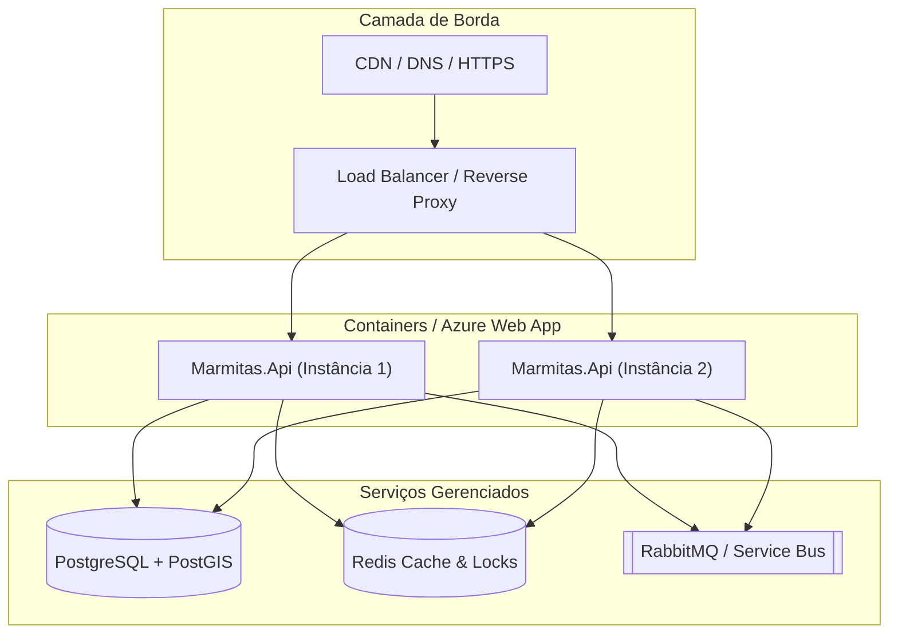

---

## 2. Máquinas de Estado

### 2.1. Pedido (`OrderStatus`)

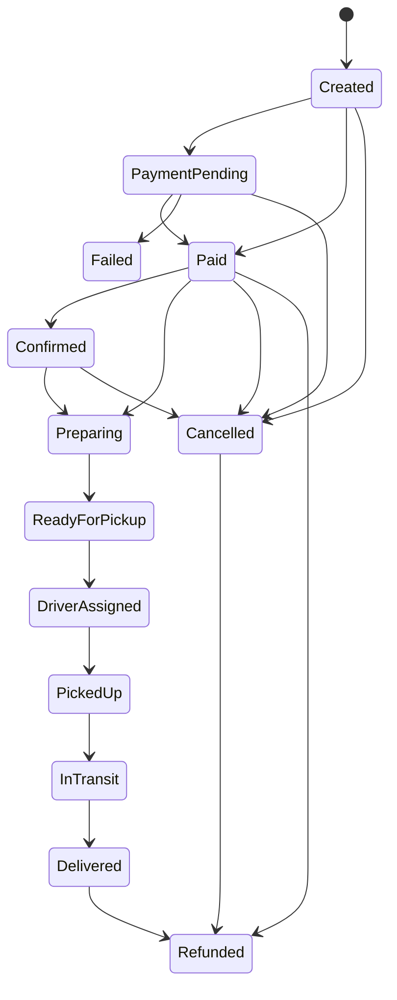

### 2.2. Pagamento (`Payment.Status`)
* `Pending` $\rightarrow$ `Authorized` $\rightarrow$ `Approved` $\rightarrow$ `Refunded` / `Chargeback`
* `Pending` $\rightarrow$ `Declined` / `Failed`

### 2.3. Assinatura (`Subscription.Status`)
* `PendingPayment` $\rightarrow$ `Active` $\leftrightarrow$ `Paused`
* `Active` $\rightarrow$ `GracePeriod` $\rightarrow$ `Suspended` / `Expired`
* `Active` / `Paused` / `GracePeriod` $\rightarrow$ `Cancelled`

### 2.4. Entrega (`Delivery.Status`)
* `ReadyForPickup` $\rightarrow$ `DriverAssigned` $\rightarrow$ `PickedUp` $\rightarrow$ `InTransit` $\rightarrow$ `Delivered` / `Cancelled`

---

## 3. Critérios de Aceite Principais

* **Cadastro e Login**:
  * *Dado* um visitante com dados válidos, *Quando* enviar `POST /api/v1/auth/registro`, *Então* a conta é criada com perfil `customer`, o consentimento LGPD é registrado e o status `201 Created` é retornado.
  * *Dado* um usuário com 5 tentativas consecutivas de senha incorreta, *Quando* tentar novo login, *Então* a conta fica temporariamente bloqueada por 15 minutos contra força bruta.
* **Pedido e Máquina de Estados**:
  * *Dado* um pedido no status `Delivered`, *Quando* houver tentativa de alterar o status para `Preparing` ou cancelar pelo cliente, *Então* o sistema rejeita a transição com `409 Conflict` (`ORDER_INVALID_STATUS_TRANSITION`).
* **Assinatura**:
  * *Dado* um cliente com assinatura ativa, *Quando* resgatar marmitas acima do limite semanal do plano, *Então* o pedido é bloqueado informando o saldo restante da semana.
* **Entrega**:
  * *Dado* um entregador logado, *Quando* não tiver preenchido CPF, CNH, Veículo e Endereço de Cobrança, *Então* a fila de entregas permanece bloqueada e o aceite de corridas é impedido.
  * *Dado* uma entrega já aceita pelo Entregador A, *Quando* o Entregador B tentar aceitar a mesma entrega, *Então* o sistema retorna `409 Conflict`.
* **Pagamento e Reembolso**:
  * *Dado* um pagamento aprovado, *Quando* o administrador acionar `POST /api/v1/pagamentos/{id}/estornar`, *Então* o pagamento e o pedido mudam para `Refunded` e um lançamento compensatório de débito é gravado no Ledger financeiro sem apagar o lançamento original.

---

## 4. Decisões Técnicas Principais

| Decisão | Recomendação Adotada | Justificativa |
| :--- | :--- | :--- |
| **Backend** | ASP.NET Core 8.0 | Alta performance, tipagem forte e suporte nativo a SignalR e Rate Limiting |
| **Arquitetura** | Modular Monolith (Clean Architecture) | Baixo custo operacional inicial com fronteiras claras para futura extração |
| **Banco de Dados** | PostgreSQL | Robustez transacional, suporte a JSON e extensão geográfica PostGIS |
| **ORM** | Entity Framework Core 8 | Produtividade, Migrations versionadas e interceptação de auditoria |
| **Cache** | MemoryCache / Redis | Redução de latência em leituras frequentes de vitrine e cardápios |
| **Tempo Real** | ASP.NET Core SignalR | Atualização instantânea de pedidos e GPS de entrega |
| **Mensageria** | System.Threading.Channels / RabbitMQ | Desacoplamento de eventos sem sobrecarga no ambiente inicial |
| **Jobs Agendados** | BackgroundService (`PeriodicTimer`) | Execução in-process para renovação de assinaturas e limpeza de tokens |
| **Frontend** | Vue 3 + Vite + TypeScript + Pinia + Tailwind | Reatividade, tipagem estrita e construção modular de painéis por perfil |
| **Autenticação** | JWT + Refresh Token + BCrypt + RBAC | Controle de acesso stateless aliado a revogação segura de sessão |

---

## 5. Critérios para Extração Futura de Microsserviços

O sistema deve permanecer como **Modular Monolith** até que métricas objetivas justifiquem a extração individual de módulos (`Order Service`, `Payment Service`, `Subscription Service`, `Delivery Service`, `Notification Service`, `Financial Service`):

1. **Escala Assimétrica**: O módulo de rastreamento/entregas (`Delivery Service`) receber volume de escrita de GPS mais de 10x superior ao throughput transacional do restante da API.
2. **Isolamento de Falhas e Compliance**: O módulo de pagamentos e Ledger (`Payment / Financial Service`) exigir certificação ou rede segregada (PCI-DSS) independente do restante do marketplace.
3. **Autonomia de Deploy**: Múltiplas squads atuando simultaneamente com conflitos de janela de implantação.
